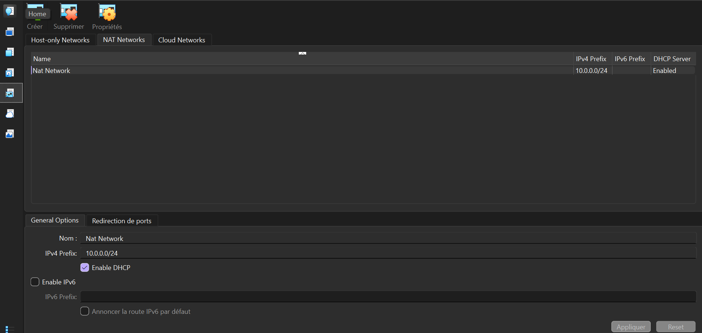
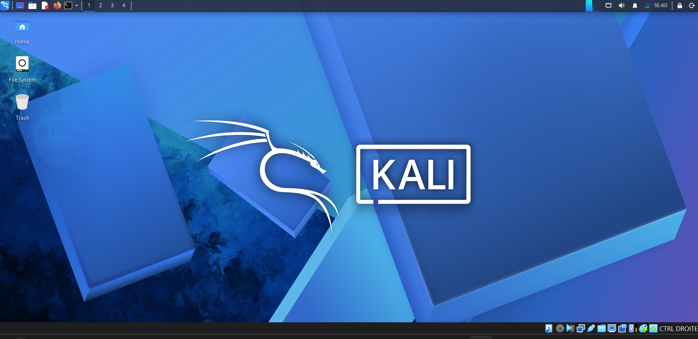

# 🔐 Cybersecurity Lab Environment Setup

**NetworkWalks – Week 01 | Project 01**

## 📌 Project Overview

This project consists of setting up a virtual cybersecurity laboratory using **VirtualBox** and **Kali Linux**.

The goal was to create a controlled environment that can be used to learn cybersecurity concepts, experiment with security tools, and prepare for future hands-on exercises.

The laboratory uses a dedicated NAT Network, allowing me to configure Kali Linux with a consistent IP address and prepare the environment for additional virtual machines in future projects.

## 🎯 Objectives

The main objectives of this project were to:

- Install and configure VirtualBox.
- Import Kali Linux as a virtual machine.
- Create a dedicated NAT Network.
- Configure Kali Linux network connectivity.
- Assign and verify the Kali VM's IP address.
- Test Internet connectivity and DNS resolution.
- Prepare a clean snapshot for future recovery.
- Document the setup process and configuration.

## 🛡️ Purpose of the Lab

I will use this laboratory to develop my cybersecurity skills through practical exercises in a controlled virtual environment.

As I progress, I plan to practice network reconnaissance, port scanning, vulnerability assessment, packet analysis, web security testing, and the use of different cybersecurity tools.

I also plan to expand the environment by adding more virtual machines for future exercises.

**Note:** This laboratory is intended for cybersecurity learning and authorized security testing only.

## 🏗️ Lab Architecture

The laboratory runs Kali Linux inside VirtualBox and connects it to a dedicated NAT Network.

The network uses the `10.0.0.0/24` address range, and the Kali VM uses the IP address `10.0.0.2/24`.

Additional virtual machines can be connected to the same network in future projects.

## ⚙️ Lab Configuration

| Component | Configuration |
|---|---|
| Host Operating System | Windows |
| Hypervisor | VirtualBox 7.2 |
| Security Operating System | Kali Linux |
| Kali VM RAM | 2048 MB |
| Virtual Network | NAT Network |
| Network Name | `NatNetwork` |
| Network Address | `10.0.0.0/24` |
| Kali IP Address | `10.0.0.2/24` |
| Default Gateway | `10.0.0.1` |
| Network Interface | `eth0` |

## 🪜 Lab Setup Procedure

### Step 1. Install 7-Zip

I installed 7-Zip to extract the Kali Linux virtual-machine archive.

Tool: [7-Zip](https://www.7-zip.org/)

### Step 2. Install VirtualBox

I used VirtualBox as the hypervisor to create and manage my Kali Linux virtual machine.

### Step 3. Create the NAT Network

I created a dedicated NAT Network in VirtualBox with the following configuration:

- **Network Name:** `NatNetwork`
- **IPv4 Prefix:** `10.0.0.0/24`
- **DHCP:** Enabled
- **IPv6:** Disabled

This network mode allows connected virtual machines to communicate with each other while providing outbound network connectivity.

### Step 4. Import Kali Linux

I downloaded Kali Linux from the official website and imported the virtual machine into VirtualBox.

The network adapter was configured as follows:

- **Attached to:** NAT Network
- **Network:** `NatNetwork`
- **Adapter Type:** Intel PRO/1000 MT Desktop

The VM was allocated **2048 MB of RAM**. I also configured a shared folder to facilitate file transfers between Windows and Kali Linux.

### Step 5. Configure the Kali Linux Network

I checked the Kali Linux network interface and verified its IP address.

The resulting configuration was:

- **IP Address:** `10.0.0.2/24`
- **Subnet Mask:** `255.255.255.0`
- **Default Gateway:** `10.0.0.1`
- **DNS:** 

- 
