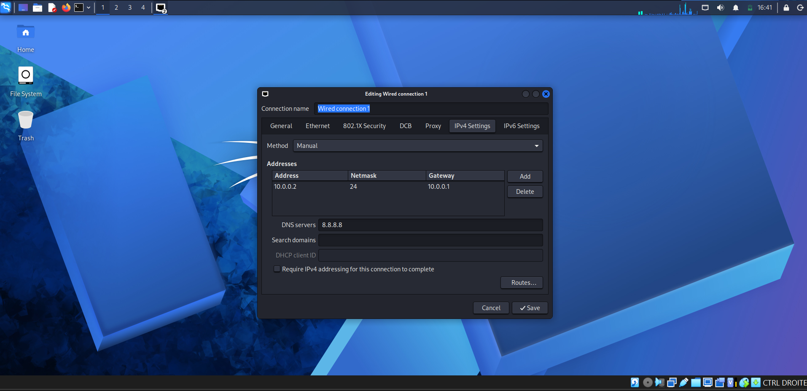

# 🔐 Cybersecurity Lab Environment Setup

**NetworkWalks – Week 01 | Project 01**

## 📌 Project Overview

This project consists of setting up a virtual cybersecurity laboratory using **VirtualBox** and **Kali Linux**.

The goal was to create a controlled environment that can be used to learn cybersecurity concepts, experiment with security tools, and prepare for future hands-on exercises.

The laboratory uses a dedicated NAT Network, allowing me to configure Kali Linux with a consistent IP address and prepare the environment for additional virtual machines in future projects.

## 🎯 Objectives

The main objectives of this project were to:

- Install and configure VirtualBox.
- Import Kali Linux as a virtual machine.
- Create a dedicated NAT Network.
- Configure Kali Linux network connectivity.
- Assign and verify the Kali VM's IP address.
- Test Internet connectivity and DNS resolution.
- Prepare a clean snapshot for future recovery.
- Document the setup process and configuration.

## 🛡️ Purpose of the Lab

I will use this laboratory to develop my cybersecurity skills through practical exercises in a controlled virtual environment.

As I progress, I plan to practice network reconnaissance, port scanning, vulnerability assessment, packet analysis, web security testing, and the use of different cybersecurity tools.

I also plan to expand the environment by adding more virtual machines for future exercises.

**Note:** This laboratory is intended for cybersecurity learning and authorized security testing only.

## 🏗️ Lab Architecture

The laboratory runs Kali Linux inside VirtualBox and connects it to a dedicated NAT Network.

The network uses the `10.0.0.0/24` address range, and the Kali VM uses the IP address `10.0.0.2/24`.

Additional virtual machines can be connected to the same network in future projects.


## ⚙️ Lab Configuration

| Component | Configuration |
|---|---|
| Host Operating System | Windows |
| Hypervisor | VirtualBox 7.2 |
| Security Operating System | Kali Linux |
| Kali VM RAM | 2048 MB |
| Virtual Network | NAT Network |
| Network Name | `NatNetwork` |
| Network Address | `10.0.0.0/24` |
| Kali IP Address | `10.0.0.2/24` |
| Default Gateway | `10.0.0.1` |
| Network Interface | `eth0` |

## 🪜 Lab Setup Procedure

### Step 1. Install 7-Zip

I installed 7-Zip to extract the Kali Linux virtual-machine archive.

Tool: [7-Zip](https://www.7-zip.org/)

### Step 2. Install VirtualBox

I used VirtualBox as the hypervisor to create and manage my Kali Linux virtual machine.

### Step 3. Create the NAT Network

I created a dedicated NAT Network in VirtualBox with the following configuration:

- **Network Name:** `NatNetwork`
- **IPv4 Prefix:** `10.0.0.0/24`
- **DHCP:** Enabled
- **IPv6:** Disabled


This network mode allows connected virtual machines to communicate with each other while providing outbound network connectivity.

### Step 4. Import Kali Linux

I downloaded Kali Linux from the official website and imported the virtual machine into VirtualBox.

The network adapter was configured as follows:

- **Attached to:** NAT Network
- **Network:** `NatNetwork`
- **Adapter Type:** Intel PRO/1000 MT Desktop

The VM was allocated **2048 MB of RAM**. I also configured a shared folder to facilitate file transfers between Windows and Kali Linux.


### Step 5. Configure the Kali Linux Network

I checked the Kali Linux network interface and verified its IP address.

The resulting configuration was:

- **IP Address:** `10.0.0.2/24`
- **Subnet Mask:** `255.255.255.0`
- **Default Gateway:** `10.0.0.1`
- **DNS:** `8.8.8.8`



  ## Step 6. Create a Clean VM Snapshot

After completing the initial configuration of my Kali Linux virtual machine, I planned to create a VirtualBox snapshot to preserve the initial state of my laboratory.

This snapshot will serve as a recovery point for my virtual machine. If future experiments affect my configuration, I will be able to restore the VM to its previous state.

**Status:** Pending — snapshot creation and verification are still required.

---

# 🔎 Lab Verification

I used network commands to check my Kali Linux configuration and test Internet connectivity. The following table summarizes my results and the additional checks I still need to complete.

| **✅ Test** | **🧾 Command** | **🎯 Result / Status** |
|---|---|---|
| 🌐 Check IP address | `ip a` | Verified: `10.0.0.2/24` |
| 🛣️ Check routing table | `ip route` | Verified: gateway `10.0.0.1` |
| 🌍 Test Internet connectivity | `ping google.com` | Successful replies received |
| 📡 Test gateway connectivity | `ping -c 4 10.0.0.1` | Not yet verified separately |
| 🔎 Test DNS resolution | `nslookup networkwalks.com` | Not yet verified separately |
| 🧰 Verify Nmap installation | `nmap --version` | Not yet verified |
| 🔄 Verify snapshot | Restore snapshot and run `ip a` | Pending snapshot creation |

### My Network Configuration

During my setup, I obtained the following network configuration:

```text
Kali IP Address: 10.0.0.2/24
Default Gateway: 10.0.0.1
Virtual Network: 10.0.0.0/24
Network Interface: eth0
```

I successfully tested Internet connectivity using `ping google.com`. This confirmed that my Kali VM could access the Internet and resolve the domain name.

---

# Problems Encountered & Solutions

I also explored a troubleshooting method that may be useful when configuring a virtual cybersecurity laboratory.

## Problem . Internet Connectivity After Network Configuration

Changing IPv4 settings can sometimes affect Internet connectivity, depending on the Kali Linux and NetworkManager configuration.

To investigate network problems, I can check the interface using `ip a`, inspect the routing table with `ip route`, and test connectivity using `ping`.

A possible workaround for certain Duplicate Address Detection (DAD) timeout issues is:

```bash
sudo nmcli connection modify "Wired connection 1" ipv4.dad-timeout 0
```


---

# 💡 What I Learned

Through this project, I gained practical experience setting up a virtual environment for cybersecurity practice.

### 1. NAT vs. NAT Network

I learned that NAT and NAT Network serve different purposes. A NAT Network allows virtual machines connected to the same virtual network to communicate with one another while providing external network connectivity.

### 2. Virtual Machine Networking

I learned how VirtualBox network adapters connect my virtual machine to a virtual network and how the selected network mode affects communication and Internet access.

### 3. IP Addressing and Network Verification

I practiced checking my network interface, identifying my assigned IPv4 address, inspecting the routing table, and testing Internet connectivity from Kali Linux.

I also learned that IP connectivity and DNS resolution are separate aspects of network troubleshooting.

### 4. VM Snapshots

I learned that snapshots provide recovery points for virtual machines. Creating a clean snapshot before experimenting with unfamiliar configurations can help me restore a known state if something goes wrong.

### 5. Technical Documentation

I learned the importance of documenting commands, configuration details, verification results, screenshots, and troubleshooting steps. Clear documentation makes my work easier to review and reproduce.

---

# 🔐 Security & Ethical Use

I created this laboratory for educational purposes and authorized cybersecurity practice. I will use it to develop my technical skills in a controlled environment and perform testing only on systems and networks for which I have permission.

---

# 🔗 Tools & Resources

- **7-Zip:** [https://7-zip.org/download.html](https://7-zip.org/download.html)
- **VirtualBox:** [https://virtualbox.org/wiki/Downloads](https://virtualbox.org/wiki/Downloads)
- **Kali Linux:** [https://kali.org/get-kali](https://kali.org/get-kali)

---

# 👤 Author

**MAROUANE Doaa**  
Cybersecurity & Cloud Computing Student 

LinkedIn: [linkedin.com/marouane/doaa](www.linkedin.com/in/doaa-marouane-bb61b4440)

---

## 📌 Project Information

**Program Name:** Cybersecurity at NetworkWalks  
**Week:** 01  
**Project:** Cybersecurity & Pentesting Lab Setup  
**Repository:** GitHub


- 
